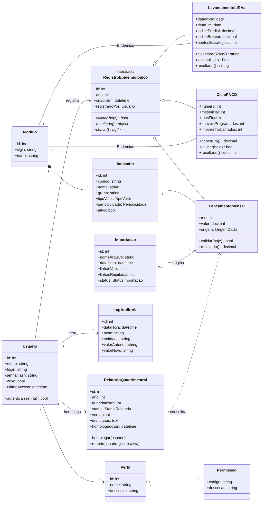

# Sistema de Indicadores da Vigilância Epidemiológica – Balsas-MA

Sistema em Python, orientado a objetos, para registrar, calcular, comparar, homologar e exportar
os indicadores da Coordenação de Vigilância Epidemiológica (VE) da Secretaria Municipal de Saúde
de Balsas-MA. Ele substitui as planilhas usadas hoje na consolidação dos relatórios quadrimestrais.

**TED 04 – Algoritmos e Programação Avançada** · Projeto Integrador com a TED 03 de
Análise e Engenharia de Sistemas · Análise e Desenvolvimento de Sistemas – UNIBALSAS · 2026

## Integrantes

- Bonifácio Pinto Costa Neto
- Esley Robson Soares Silva Filho
- Gabriel Silva da Rocha

## O que o sistema faz

| Perfil | Funções |
|---|---|
| **Digitador** (técnicos da VE) | Lança os totais mensais do SINAN, LACEN e SIM/SINASC, os ciclos do PNCD e o LIRAa; importa planilha CSV com prévia; consulta o painel |
| **Gestor** (secretário e gestores) | Painel epidemiológico, comparativo entre períodos, consultas com filtros e exportação de relatórios |
| **Coordenador** da VE | Tudo o que o Gestor faz, mais homologar e reabrir o relatório do quadrimestre |
| **Administrador** | Cadastra, inativa e reativa usuários, troca perfis, redefine senhas e consulta a auditoria |

Regras importantes:

- Totais nunca são digitados, sempre calculados (RN06).
- Variação percentual em relação ao ano anterior (RN07).
- Cobertura do PNCD (RN08) e risco do LIRAa (RN09).
- Lançamento repetido só com confirmação (RN04).
- Período homologado fica bloqueado (RN11).
- Planilhas com dados de pacientes são recusadas (RN01, LGPD).

## Requisitos para execução

- **Python 3.10 ou superior** ([python.org](https://www.python.org/downloads/)).
- **pytest**, apenas para rodar os testes. O sistema em si não usa nenhuma biblioteca externa.

## Instalação

```bash
git clone https://github.com/gabrielsrochadev/indicadores-ve/
cd indicadores-ve
python -m pip install -r requirements.txt
```

> No Windows, se `python` não funcionar, use `py` no lugar (ex.: `py -m pip install -r requirements.txt`).
> Opcional: crie um ambiente virtual antes (`python -m venv .venv`).

## Como executar

```bash
python main.py
```

Na primeira execução, o banco `data/banco.json` é criado automaticamente com os dados reais do
relatório do 2º quadrimestre de 2026. Para recriar o banco do zero, com a conferência dos totais:

```bash
python scripts/seed.py --forcar
```

Outra forma de iniciar, com o pacote instalado (`python -m pip install -e .`): `python -m indicadores_ve`.

### Usuários de demonstração

| Login | Senha | Perfil |
|---|---|---|
| `digitador` | `digit2026` | Digitador |
| `gestor` | `gestor2026` | Gestor |
| `coordenador` | `coord2026` | Coordenador |
| `admin` | `admin2026` | Administrador |

> A senha não aparece enquanto é digitada.

### Arquivos de exemplo para importação

- `data/exemplo_importacao.csv`: valores **fictícios** de setembro e outubro de 2026, com 6 linhas
  válidas e 2 com erro de propósito (valor negativo e indicador inexistente).
- `data/exemplo_rejeitado_lgpd.csv`: tem a coluna `nome_paciente` e é recusado inteiro (RN01).

Layout do CSV (separador `;` ou `,`): `modulo;codigo_indicador;ano;mes;valor`

## Como executar os testes

```bash
python -m pytest
```

Resultado esperado: **245 testes aprovados**. Com relatório de cobertura (98%):

```bash
python -m pytest --cov=indicadores_ve --cov-report=term-missing
```

| Arquivo | O que valida |
|---|---|
| `tests/test_criterios_aceitacao.py` | Um teste para cada critério de aceitação da SRS (CA01 a CA14) |
| `tests/test_models.py` | Classes, encapsulamento, herança, polimorfismo, abstração, relacionamentos e métodos especiais |
| `tests/test_services.py` | Regras de negócio, permissões, importação, cálculos e exportação |
| `tests/test_persistence.py` | Gravação e leitura em JSON, backup, arquivo corrompido e carga inicial |
| `tests/test_cli.py` | Menu no terminal com usuário simulado e scripts de inicialização |

Os testes usam um relógio fixo (24/11/2026), então o resultado é o mesmo em qualquer dia.

## Estrutura do projeto

```
indicadores-ve/
├── main.py                      # inicia o sistema (python main.py)
├── pyproject.toml / requirements.txt
├── src/indicadores_ve/
│   ├── models/                  # classes do Diagrama de Classes (domínio)
│   ├── services/                # regras de negócio e casos de uso
│   ├── persistence/             # Repositorio (abstrato), RepositorioJSON, serialização
│   ├── cli/                     # menu no terminal
│   └── excecoes.py              # uma exceção para cada tipo de regra violada
├── tests/                       # suíte pytest
├── data/
│   ├── dados_iniciais.json      # dados do relatório do 2º quadrimestre/2026
│   └── exemplo_*.csv            # arquivos para demonstrar a importação
├── scripts/seed.py              # cria ou recria o banco
└── docs/
    ├── mapeamento_e_alteracoes.md   # UML → código, alterações, rastreabilidade
    ├── roteiro_defesa.md            # roteiro da apresentação em laboratório
    └── img/                         # diagramas de classes
```

## Programação Orientada a Objetos

| Pilar | Onde ver |
|---|---|
| **Abstração** | `RegistroEpidemiologico`, `Repositorio` e `Exportador` são classes abstratas (ABC) |
| **Herança** | `LancamentoMensal`, `CicloPNCD` e `LevantamentoLIRAa` herdam de `RegistroEpidemiologico`; `RepositorioJSON` e `RepositorioMemoria` herdam de `Repositorio`; `ExportadorCSV` e `ExportadorTXT` herdam de `Exportador` |
| **Polimorfismo** | `resultado()` devolve 418, 98,57 ou "satisfatório" conforme a subclasse; `ServicoLancamentos.registrar()` aceita qualquer um dos três registros |
| **Encapsulamento** | `@property` com validação nos setters (ex.: valor negativo é recusado); senha só como hash em atributo privado |
| **Métodos especiais** | `__eq__`/`__hash__` (Usuario, registros, Permissao), `__len__` (Importacao, Modulo), `__contains__` (Modulo, Perfil), `__str__`/`__repr__` |
| **Relacionamentos** | Composição Modulo ◆ Indicador; agregação Perfil ◇ Permissao (alteração A11: no diagrama aprovado era associação simples); demais associações e dependência conforme o diagrama |



## Persistência

- Os dados ficam em `data/banco.json`, gravados por `RepositorioJSON`.
- A gravação é segura: o sistema escreve primeiro um arquivo temporário e depois troca pelo original.
- Há uma cópia de backup por dia em `data/backups/`, mantida por 30 dias.
- As senhas nunca são gravadas, apenas o hash.

## Rastreabilidade e alterações

O arquivo [`docs/mapeamento_e_alteracoes.md`](docs/mapeamento_e_alteracoes.md) traz:

- o mapeamento de cada classe e relacionamento do diagrama da TED 03 para o código;
- as **11 alterações justificadas** (A01–A11) em relação à especificação aprovada. Exemplos: a
  herança `RegistroEpidemiologico`, a agregação Perfil ◇ Permissao, a persistência em JSON, a interface em terminal e a exportação em CSV/TXT;
- a tabela **requisito → código → teste** para todos os RF, RN e RNF;
- observações sobre os dados: na carga, o sistema encontrou três erros de soma no relatório
  oficial (SINAN 2.054 × 2.372; LACEN 2.815 × 2.818; pacientes do laboratório 1.790 × 1.490).

## Limitações desta versão

- Interface em terminal (sem web). Por isso RNF02, RNF04, RNF07 e RNF09 ficam fora do escopo (A05).
- Exportação em CSV e TXT, sem PDF nem XLSX (A06). Importação apenas de CSV (A07).
- Sem dados de 2025 por agravo para SINAN e LACEN, porque o relatório oficial só traz o total
  geral. Por isso a variação desses cartões aparece como "—".
