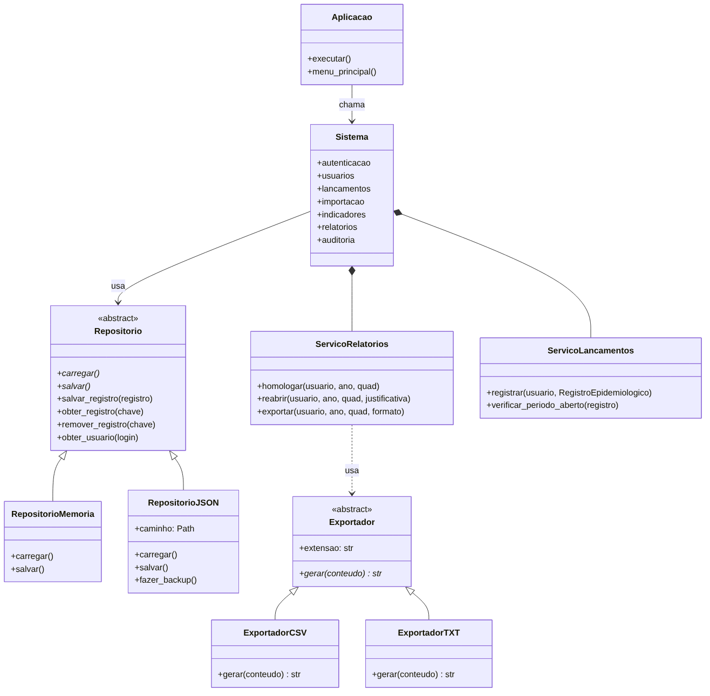
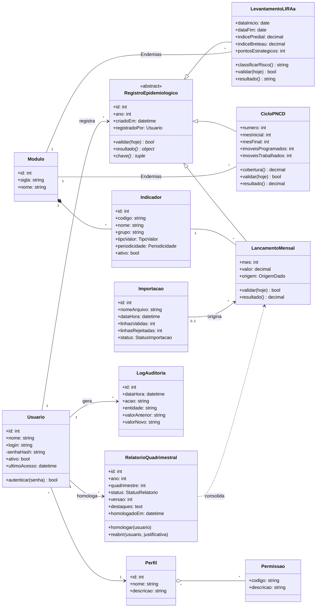

# Mapeamento UML → código e registro de alterações

**Projeto:** Sistema de Indicadores da Vigilância Epidemiológica de Balsas-MA
**TED 04 – Algoritmos e Programação Avançada** (continuação da TED 03 de Análise e Engenharia de Sistemas)
**Referência:** SRS v1.0 aprovada em 18/11/2026 e Documento Formal de Requisitos (baseline 1.0) – Diagrama de Classes (Figura 5/6)
**Equipe:** Bonifácio Pinto Costa Neto · Esley Robson Soares Silva Filho · Gabriel Silva da Rocha

Este documento mostra como cada elemento do Diagrama de Classes aprovado foi levado para o código
e registra, com justificativa, toda diferença entre a especificação e a implementação
(exigência do item 3.1 da TED 04).

---

## 1. Decisões de arquitetura

| Decisão | Escolha | Motivo |
|---|---|---|
| Linguagem | Python 3.10+ | Exigência da disciplina. |
| Interface | Menu interativo no terminal | Foco da TED em POO, persistência e testes (ver A05). |
| Persistência | Arquivo JSON (`data/banco.json`) | Conteúdo estudado na disciplina (ver A04). |
| Testes | pytest | Exigência da TED (unittest ou pytest). |
| Dependências externas | Somente `pytest` | Instalação simples para a validação em laboratório. |

Organização em camadas, seguindo a arquitetura em três camadas da SRS (seção 5):

```
src/indicadores_ve/
├── models/        → classes do Diagrama de Classes (domínio)
├── services/      → regras de negócio (RN01–RN11) e casos de uso (UC01–UC10)
├── persistence/   → leitura e gravação em JSON
└── cli/           → menu no terminal (substitui a interface web)
```

---

## 2. Mapeamento das classes

| Classe UML | Arquivo | Observações |
|---|---|---|
| `Modulo` | `models/modulo.py` | Dono dos seus indicadores (composição). |
| `Indicador` | `models/indicador.py` | `tipoValor` e `periodicidade` viram enums. |
| `LancamentoMensal` | `models/registros.py` | Passa a herdar de `RegistroEpidemiologico` (A01). |
| `CicloPNCD` | `models/registros.py` | Herda de `RegistroEpidemiologico`; `cobertura()` = RN08. |
| `LevantamentoLIRAa` | `models/registros.py` | Herda de `RegistroEpidemiologico`; `classificarRisco()` = RN09. |
| `Usuario` | `models/usuario.py` | `senhaHash` privado; `autenticar()` com hash (RNF05). |
| `Perfil` | `models/usuario.py` | Agrega permissões. |
| `Permissao` | `models/usuario.py` | Código da ação permitida (RN03). |
| `Importacao` | `models/importacao.py` | Guarda linhas válidas e rejeitadas da prévia (RF11). |
| `RelatorioQuadrimestral` | `models/relatorio.py` | `homologar()` e `reabrir()` (RF14, RN11). |
| `LogAuditoria` | `models/auditoria.py` | Registro de toda operação de escrita (RNF10). |
| *(nova)* `RegistroEpidemiologico` | `models/registros.py` | Classe abstrata (A01). |
| *(enums)* | `models/enums.py` | `TipoValor`, `Periodicidade`, `OrigemDado`, `StatusRelatorio`, `StatusImportacao` (A03). |

Nomes no código seguem o padrão Python (`snake_case`): `classificarRisco()` → `classificar_risco()`,
`imoveisProgramados` → `imoveis_programados` e assim por diante. A correspondência é 1 para 1.

---

## 3. Mapeamento dos relacionamentos

| Relacionamento no diagrama | Tipo | Como ficou no código |
|---|---|---|
| `Modulo` ◆— `Indicador` (1 → *) | **Composição** | O `Modulo` cria os indicadores (`modulo.adicionar_indicador(...)`) e os guarda numa lista interna. O indicador não existe sem o módulo: remover o módulo remove os indicadores. |
| `Perfil` — `Permissao` (* → *) | **Agregação** (associação simples no diagrama aprovado – ver A11) | O perfil guarda referências a permissões que existem independentemente e podem ser compartilhadas por vários perfis. |
| `Usuario` → `Perfil` (* → 1) | Associação | Atributo `usuario.perfil`. |
| `Indicador` — `LancamentoMensal` (1 → *) | Associação | Atributo `lancamento.indicador` (ver A02). |
| `Modulo` — `CicloPNCD` / `LevantamentoLIRAa` (1 → *) | Associação | Atributo `modulo` = módulo Endemias. |
| `Usuario` registra `LancamentoMensal` (1 → *) | Associação | Atributo `registrado_por` em todo registro. |
| `Importacao` origina `LancamentoMensal` (0..1 → *) | Associação | Atributo `lancamento.importacao_id` (vazio quando digitado). |
| `Usuario` homologa `RelatorioQuadrimestral` (1 → *) | Associação | Atributo `homologado_por`. |
| `Usuario` gera `LogAuditoria` (1 → *) | Associação | Atributo `usuario` no log. |
| `RelatorioQuadrimestral` ⇢ `LancamentoMensal` | Dependência (sem multiplicidades – ver A11) | O relatório recebe os lançamentos no método `consolidar(lancamentos)` e não os guarda. |
| *(nova)* `RegistroEpidemiologico` ◁— 3 subclasses | **Herança** | Ver A01. |

A generalização de atores do diagrama de casos de uso (*Coordenador herda de Gestor*) foi
implementada por **permissões**: o perfil Coordenador recebe todas as permissões do Gestor
mais `homologar_relatorio`. Isso é fiel ao diagrama de classes aprovado, que modela perfis
como dados (`Perfil`/`Permissao`) e não como subclasses de `Usuario`.

---

## 4. Pilares da POO e métodos especiais

| Pilar | Onde aparece |
|---|---|
| **Abstração** | `RegistroEpidemiologico` (ABC) define o contrato `validar()`, `resultado()` e `chave()`. `Repositorio` (ABC) define o contrato de persistência (`carregar()`/`salvar()`). `Exportador` (ABC) define o contrato de exportação (`gerar()`). |
| **Herança** | `LancamentoMensal`, `CicloPNCD` e `LevantamentoLIRAa` herdam período, autor, data de criação e auditoria de `RegistroEpidemiologico`. `RepositorioMemoria` (testes) e `RepositorioJSON` (sistema) herdam de `Repositorio`. `ExportadorCSV` e `ExportadorTXT` herdam de `Exportador`. |
| **Polimorfismo** | Cada registro sobrescreve `validar()` e `resultado()`: o lançamento devolve o valor, o ciclo devolve a cobertura % e o LIRAa devolve a classificação de risco. O `ServicoLancamentos.registrar()` recebe qualquer um dos três e os trata pela mesma interface. Na exportação, `gerar()` produz CSV ou TXT a partir do mesmo conteúdo. |
| **Encapsulamento** | `@property` com validação nos setters (ex.: `valor` não aceita negativo, `mes` só aceita 1–12); `__senha_hash` privado; listas internas expostas como cópia somente leitura. |

**Métodos especiais (com uso real no sistema):**

| Método | Classe | Uso |
|---|---|---|
| `__eq__` / `__hash__` | `Usuario` | Dois usuários são o mesmo se têm o mesmo login (impede login duplicado). |
| `__eq__` | `LancamentoMensal` | Mesma chave indicador + ano + mês = mesmo lançamento (base da RN04). |
| `__len__` | `Importacao` | `len(importacao)` = total de linhas lidas do arquivo (prévia do RF11). |
| `__len__` | `Modulo` | Quantidade de indicadores do módulo. |
| `__contains__` | `Modulo`, `Perfil` | `"DENGUE" in modulo_sinan` e `Permissao.VER_PAINEL in perfil`. |
| `__eq__` / `__hash__` | `Permissao` | Mesma permissão = mesmo código (o perfil guarda um conjunto sem repetição). |

> O método polimórfico chama-se `resultado()` (e não `indicador()`) porque `LancamentoMensal`
> já tem o atributo `indicador`, que representa a associação com a classe `Indicador`.
> O método abstrato `mes_referencia` posiciona cada registro no quadrimestre (RN10):
> mês do lançamento, último mês do ciclo PNCD ou mês de término do LIRAa.
| `__str__` / `__repr__` | Todas as entidades | Exibição no menu (`__str__`) e depuração/testes (`__repr__`). |

---

## 5. Registro de alterações em relação à especificação aprovada

| Nº | Artefato afetado | Alteração | Justificativa técnica |
|---|---|---|---|
| **A01** | Diagrama de Classes | Criada a classe abstrata `RegistroEpidemiologico`, superclasse de `LancamentoMensal`, `CicloPNCD` e `LevantamentoLIRAa`. Consequências: `id`, `ano` e `criadoEm` passam para a superclasse; a associação `Usuario registra` passa a apontar para a superclasse (vale para os três tipos); `validar()` passa a receber a data de referência (`validar(hoje)`); novos métodos `resultado()`, `chave()` e `mes_referencia`. | As três classes têm a mesma responsabilidade (registrar um dado de um período, se validar e gerar um indicador). A superclasse elimina código repetido e permite tratar os três de forma polimórfica. Também resolve a inconsistência entre a RN05 (inteiros) e os índices decimais do LIRAa: cada subclasse valida o seu tipo de dado. |
| **A02** | Diagrama de Classes | A associação `Indicador 1 — * LancamentoMensal` passa a ser direta. `Permissao` se relaciona apenas com `Perfil`. | Correção de erro de traçado: no diagrama, a linha de `Indicador` termina em `Permissao`, sugerindo uma relação `Permissao — LancamentoMensal` que não tem sentido no domínio nem nos requisitos. |
| **A03** | Diagrama de Classes | Definidos os valores dos enums: `TipoValor` (INTEIRO, DECIMAL), `Periodicidade` (MENSAL, BIMESTRAL, QUADRIMESTRAL), `OrigemDado` (DIGITACAO, IMPORTACAO), `StatusRelatorio` (RASCUNHO, HOMOLOGADO, REABERTO), `StatusImportacao` (PENDENTE, CONFIRMADA, CANCELADA). O atributo `Importacao.status`, que no diagrama era `string`, passa a usar `StatusImportacao`. | O diagrama usava os tipos sem definir seus valores. Usar um enum também em `Importacao.status` impede situações inválidas, como fazem os outros atributos de situação. |
| **A04** | SRS seção 5 e 10 (banco relacional) | Persistência em arquivo JSON. | Conteúdo trabalhado na disciplina. A camada `persistence/` usa a interface abstrata `Repositorio`, então trocar JSON por banco relacional no futuro não altera as regras de negócio. |
| **A05** | SRS seção 5 e 10 (web, API REST) | Interface em menu no terminal. RNF02 (responsividade), RNF04 (disponibilidade), RNF07 (navegadores) e RNF09 (HTTPS) ficam fora desta versão. | A TED avalia POO, persistência e testes. As regras de negócio ficam nos `services/`, independentes da interface, prontas para uma futura camada web. |
| **A06** | RF08 (PDF e Excel) | Exportação em **CSV** (abre no Excel) e em **relatório de texto (.txt)**, com cabeçalho da SMS, período, data/hora de emissão e situação. | Gerar PDF e XLSX exige bibliotecas externas. Os formatos escolhidos usam só a biblioteca padrão e mantêm o conteúdo exigido pelo CA de RF08. |
| **A07** | RF11 (CSV ou XLSX) | Importação apenas de **CSV**. | Mesmo motivo de A06. |
| **A08** | RN05 | A regra "inteiros ≥ 0" vale para indicadores do tipo INTEIRO. Índices do LIRAa (IIP e IB) são decimais ≥ 0. | Os índices do LIRAa são decimais (ex.: 0,2) e a RN05, como escrita, os rejeitaria. |
| **A09** | RF04 / carga inicial | Na carga inicial, os dados do SIM/SINASC entram como total do quadrimestre, lançado no último mês (agosto). | O relatório oficial só traz os totais do quadrimestre, sem divisão mensal. O lançamento mensal continua disponível para os próximos meses. |
| **A10** | RNF11 (backup) | Backup implementado como cópia datada do arquivo JSON a cada gravação, mantendo as cópias dos últimos 30 dias. | Adaptação do backup do banco de dados à persistência em arquivo. |
| **A11** | Diagrama de Classes | O relacionamento `Perfil * — * Permissao`, que no diagrama aprovado é uma associação simples, passa a ser **agregação** (`Perfil ◇— Permissao`). A dependência `RelatorioQuadrimestral ⇢ LancamentoMensal` ("consolida") fica sem multiplicidades. | A permissão existe independentemente do perfil e é compartilhada por vários perfis (o mesmo objeto `ver_painel` está no Digitador, no Gestor e no Coordenador); remover um perfil não remove suas permissões. Essa é a semântica de agregação (parte compartilhada, ciclo de vida independente), que a associação simples não expressa. Na dependência, o relatório não guarda os lançamentos, apenas os recebe no método `consolidar()`, por isso não cabem multiplicidades. |

Atributos e métodos que aparecem no código sem estar escritos no diagrama são consequência
direta dos relacionamentos (ex.: `lancamento.indicador`, `relatorio.homologado_por`) ou
auxiliares internos (ex.: `usuario.tem_permissao()`), sem mudar responsabilidades.

---

## 6. Persistência e carga inicial

- **Arquivo:** `data/banco.json`, criado por `python scripts/seed.py` a partir de `data/dados_iniciais.json`.
- **Formato:** cada registro epidemiológico leva o campo `"tipo"` com o nome da subclasse
  (`LancamentoMensal`, `CicloPNCD` ou `LevantamentoLIRAa`), para a leitura recriar o objeto da
  classe certa. Os indicadores são gravados dentro do módulo (composição). As associações são
  gravadas pelo identificador (login, código do indicador) e reconstruídas como objetos na
  leitura. As permissões voltam como objetos compartilhados entre os perfis (agregação).
- **Segurança:** a senha nunca é gravada, só o hash PBKDF2 (RNF05).
- **Gravação segura:** escreve num arquivo temporário e troca pelo original de uma vez.
- **Backup (A10):** a primeira gravação de cada dia guarda uma cópia em `data/backups/`. As cópias com mais de 30 dias são apagadas.

### Observações sobre os dados da carga inicial

Os dados vêm do relatório oficial do 2º quadrimestre de 2026 (somente totais agregados, RN01).
A carga passa pelas validações das classes, e o `seed.py` compara os totais **calculados** pelo
sistema com os **informados** no relatório:

| Total | Calculado pelo sistema | Informado no relatório |
|---|---|---|
| Notificações SINAN (mai.–ago./2026) | **2.054** | 2.372 |
| Exames enviados ao LACEN | **2.815** | 2.818 |
| Pacientes atendidos no laboratório da VE | **1.790** | 1.490 |

As três divergências são evidência prática da RN06 (totais nunca são digitados).

- **SIM/SINASC:** o relatório só traz o total do quadrimestre, que foi lançado em agosto (A09).
- **SINAN e LACEN de 2025:** o relatório só tem o total geral (2.138 e 1.674), sem divisão por
  agravo ou exame. Por isso não há carga de 2025 para esses módulos, e o painel mostra "—" na
  variação desses cartões.
- **PNCD:** o relatório chama os dois ciclos de "Ciclo 01". Na carga foram numerados 3 (mai./jun.)
  e 4 (ago./set.) para não violar a RN04. O ciclo 4 termina em setembro e por isso pertence ao
  3º quadrimestre (RN10).

---

## 7. Diagrama de Classes revisado (com A01–A03 e A11)


Classes de implementação (persistência, exportação e serviços), que não fazem parte do domínio
mas também usam herança e polimorfismo:



Código-fonte Mermaid dos diagramas: `docs/diagrama_classes.mmd` e `docs/diagrama_implementacao.mmd`.



---

## 8. Rastreabilidade requisito → código → teste

**Suíte:** 245 testes automatizados (pytest), 100% aprovados, cobertura de 98% do código.
Comando: `python -m pytest` (com cobertura: `python -m pytest --cov=indicadores_ve`).

| Arquivo de teste | Testes | O que valida |
|---|---|---|
| `tests/test_criterios_aceitacao.py` | 18 | Um teste por critério de aceitação da SRS (CA01–CA14), com os dados reais do relatório |
| `tests/test_models.py` | 112 | Classes: criação, encapsulamento, herança, polimorfismo, abstração, relacionamentos e métodos especiais |
| `tests/test_services.py` | 72 | Regras de negócio, permissões, importação, cálculos e exportação |
| `tests/test_persistence.py` | 21 | Gravar e recarregar em JSON, backup, arquivo corrompido e carga inicial |
| `tests/test_cli.py` | 22 | Menu no terminal com usuário simulado, `main.py` e `scripts/seed.py` |

### 8.1 Requisitos funcionais

| RF | Requisito | Onde está no código | Teste de aceitação |
|---|---|---|---|
| RF01 | Registrar notificações do SINAN | `LancamentoMensal`; `ServicoLancamentos.lancar_valor()` | `test_ca01_rf01_registrar_notificacao_sinan` |
| RF02 | Registrar exames do LACEN e produção do laboratório | `LancamentoMensal`; módulo LACEN na carga inicial | `test_ca02_rf02_registrar_exames_lacen`, `test_ca02_rf02_producao_do_laboratorio_da_ve` |
| RF03 | Registrar LIRAa e ciclos do PNCD | `CicloPNCD`, `LevantamentoLIRAa`; `ServicoLancamentos.registrar()` | `test_ca03_rf03_pncd_e_liraa` |
| RF04 | Registrar dados vitais (SIM/SINASC) | `LancamentoMensal`; módulo SIM_SINASC | `test_ca04_rf04_dados_vitais_comparados_ao_ano_anterior` |
| RF05 | Painel epidemiológico | `ServicoIndicadores.painel()`; `Aplicacao.painel()` | `test_ca05_rf05_painel_abre_no_ultimo_quadrimestre`, `test_ca05_rnf03_painel_em_ate_3_segundos` |
| RF06 | Comparar períodos | `ServicoIndicadores.comparar()`; `Periodo` | `test_ca06_rf06_comparativo_entre_periodos` |
| RF07 | Filtrar indicadores | `ServicoIndicadores.filtrar_indicadores()` | `test_ca07_rf07_filtro_por_grupo`, `test_ca07_rf07_filtro_por_sistema_de_origem` |
| RF08 | Exportar relatórios (A06: CSV e TXT) | `ServicoRelatorios.exportar()`; `Exportador`, `ExportadorCSV`, `ExportadorTXT` | `test_ca08_rf08_exportacao_igual_a_tela_com_cabecalho` |
| RF09 | Autenticar e controlar acesso | `Usuario.autenticar()`; `ServicoAutenticacao`; `exigir_permissao()`; `Aplicacao.opcoes()` | `test_ca09_rf09_gestor_nao_acessa_lancamento` |
| RF10 | Gerenciar usuários | `ServicoUsuarios` | `test_ca10_rf10_usuario_inativo_nao_entra` |
| RF11 | Importar planilha (A07: CSV) | `Importacao`; `ServicoImportacao.pre_visualizar()` / `confirmar()` | `test_ca11_rf11_importar_120_linhas` |
| RF12 | Validar dados de entrada | setters das classes; `validar()`; `ServicoImportacao.validar_layout()` | `test_ca12_rf12_valor_negativo_rejeitado`, `test_ca12_rf12_rn01_coluna_de_dado_pessoal_rejeitada` |
| RF13 | Calcular indicadores | `ServicoIndicadores.total()`; `CicloPNCD.cobertura()`; `LevantamentoLIRAa.classificar_risco()` | `test_ca13_rf13_totais_recalculados_automaticamente` |
| RF14 | Homologar relatório quadrimestral | `RelatorioQuadrimestral.homologar()`; `ServicoRelatorios.homologar()` | `test_ca14_rf14_periodo_homologado_bloqueia_alteracoes` |

### 8.2 Regras de negócio

| RN | Regra | Onde está no código | Testes principais |
|---|---|---|---|
| RN01 | LGPD: só totais agregados; arquivo com coluna pessoal é rejeitado | `ServicoImportacao.validar_layout()`; `DadoPessoalDetectado` | `test_rn01_colunas_de_dado_pessoal_rejeitam_o_arquivo` (6 casos), `test_importar_arquivo_com_dado_pessoal` |
| RN02 | Sem integração com sistemas oficiais | Entrada só por digitação (`ServicoLancamentos`) ou planilha (`ServicoImportacao`) | Coberta pelos testes de RF01–RF04 e RF11 |
| RN03 | Acesso por perfil | `criar_perfis_padrao()`; `exigir_permissao()`; `RelatorioQuadrimestral._exigir_coordenador()` | `test_rn03_so_digitador_lanca`, `test_permissoes_por_perfil_quadro3_srs`, `test_menu_mostra_so_o_que_o_perfil_pode` |
| RN04 | Lançamento único; substituição com confirmação | `RegistroEpidemiologico.chave()` / `__eq__`; `ServicoLancamentos.registrar()` | `test_rn04_duplicado_exige_confirmacao`, `test_eq_e_hash_pela_chave_rn04`, `test_lancar_e_substituir_com_confirmacao` |
| RN05 | Valores ≥ 0, inteiros (A08) e só meses encerrados | `LancamentoMensal.valor` (setter); `validar()` | `test_rn05_valor_invalido`, `test_rn05_indicador_inteiro_recusa_decimal`, `test_rn05_mes_nao_encerrado` |
| RN06 | Totais sempre calculados | `ServicoIndicadores.total()`; `RelatorioQuadrimestral.consolidar()` | `test_rn06_consolidar_soma_so_o_quadrimestre`, `test_rn06_carga_evidencia_erros_de_soma_do_relatorio` |
| RN07 | Variação percentual; "—" se o anterior for zero | `ServicoIndicadores.variacao_percentual()` / `formatar_variacao()` | `test_rn07_variacao` (4 casos) |
| RN08 | Cobertura do PNCD | `CicloPNCD.cobertura()` | `test_rn08_cobertura` |
| RN09 | Risco do LIRAa | `LevantamentoLIRAa.classificar_risco()` | `test_rn09_classificacao` (6 casos) |
| RN10 | Quadrimestres; comparar só períodos do mesmo tipo | `quadrimestre_do_mes()`; `Periodo`; `ServicoIndicadores.comparar()` | `test_rn10_quadrimestre_do_mes`, `test_comparar_periodos_de_tipos_diferentes_rn10` |
| RN11 | Período homologado bloqueado; reabertura justificada | `ServicoLancamentos.verificar_periodo_aberto()`; `RelatorioQuadrimestral.reabrir()` | `test_rn11_reabertura_exige_justificativa`, `test_rn11_bloqueio_vale_so_para_o_quadrimestre_homologado`, `test_rn11_excluir_e_bloqueado_em_periodo_homologado` |

### 8.3 Requisitos não funcionais

| RNF | Situação nesta versão | Onde / teste |
|---|---|---|
| RNF01 Usabilidade | Atendido no terminal: menus numerados, valores padrão entre colchetes e mensagens de correção | `test_entradas_invalidas_sao_perguntadas_de_novo` |
| RNF02 Responsividade | Fora do escopo (A05: sem interface web) | — |
| RNF03 Desempenho | Atendido | `test_ca05_rnf03_painel_em_ate_3_segundos` |
| RNF04 Disponibilidade | Fora do escopo (A05: aplicação local, sem servidor) | — |
| RNF05 Segurança de acesso | Atendido: senha ≥ 8 caracteres, hash PBKDF2 com sal, sessão de 30 min | `test_rnf05_*` (6 testes), `test_rnf05_sessao_expira_apos_30_minutos` |
| RNF06 Privacidade (LGPD) | Atendido: modelo sem campos de pacientes; importação bloqueia colunas pessoais | ver RN01 |
| RNF07 Compatibilidade | Fora do escopo (A05: sem navegador) | — |
| RNF08 Manutenibilidade | Atendido: novo agravo ou exame por cadastro (`Modulo.adicionar_indicador()`); inativar sem apagar o histórico | `test_indicador_inativado_continua_no_modulo` |
| RNF09 Comunicação HTTPS | Fora do escopo (A05: sem rede) | — |
| RNF10 Auditoria | Atendido: incluir, substituir, excluir, importar, exportar, homologar, reabrir, usuários e login | `test_incluir_gera_auditoria`, `test_homologacao_usuario_inativo_importacao_e_logs_persistem` |
| RNF11 Backup | Atendido (A10): cópia diária com retenção de 30 dias | `test_a10_backup_diario_com_retencao_de_30_dias` |
